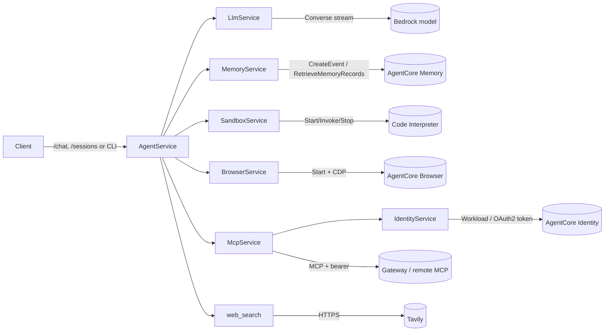
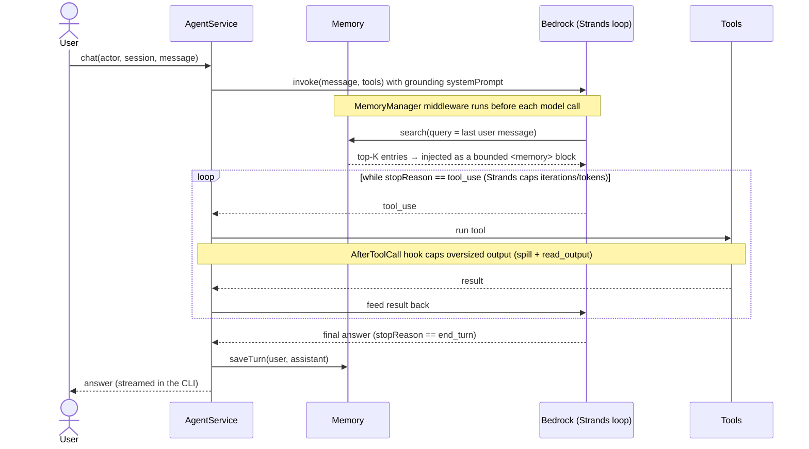
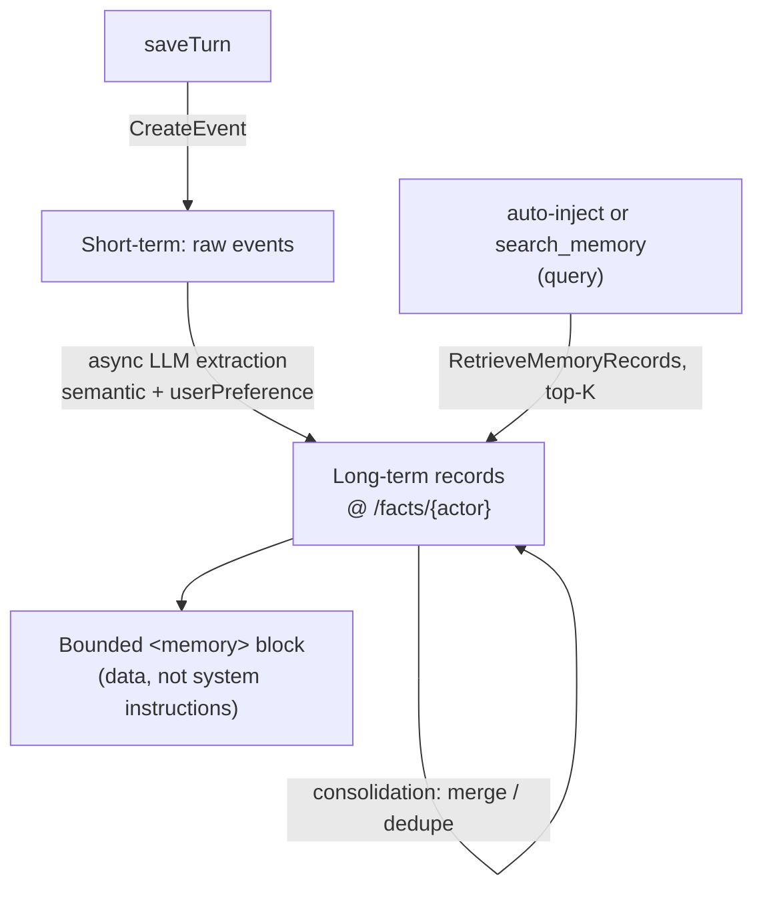
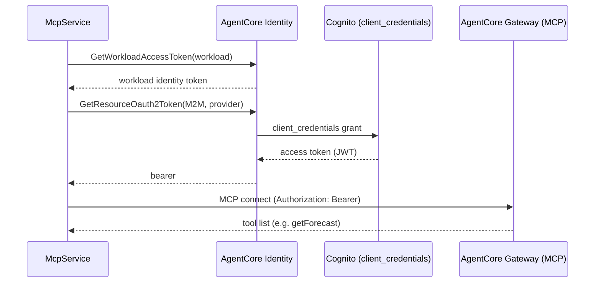
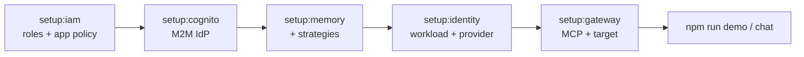

# aws-agent-demo

A NestJS AI agent running on **Amazon Bedrock AgentCore**. One agent loop
(Strands Agents SDK) on Bedrock, with each AgentCore feature wired as its own
module. No mock mode — it always talks to real AWS.

| AgentCore feature | Module | API |
|---|---|---|
| Long-term memory | `src/memory` | `CreateEvent`, `RetrieveMemoryRecords` |
| Chat sessions (new / list) | `src/session` | `ListSessions` + session ids |
| OAuth (machine-to-machine) | `src/identity` | `GetWorkloadAccessToken`, `GetResourceOauth2Token` |
| MCP tools + runtime install | `src/mcp` | Strands `McpClient` → Gateway / remote MCP |
| Code sandbox | `src/sandbox` | `StartCodeInterpreterSession`, `InvokeCodeInterpreter` |
| Cloud browser | `src/browser` | `StartBrowserSession` + Playwright over SigV4-signed CDP |

### Tools the agent can call

Assembled per turn in `AgentService.prepareAgent` (`src/agent/agent.service.ts`):

| Tool | Source | What it does |
|---|---|---|
| `run_code` | `src/sandbox` | Run Python/JS/TS in the Code Interpreter sandbox |
| `browse` | `src/browser` | Open a URL in the cloud browser, return rendered text |
| `web_search` | `src/tools/web-search` | Tavily web search (only if `TAVILY_API_KEY` set) |
| `search_memory` | `MemoryManager.getTools()` | Actively recall past facts with its own query |
| `install_mcp` | `src/mcp` | Register a remote MCP server at runtime |
| `read_output` | `src/agent/output-cap` | Page through a truncated tool output |
| Gateway / installed | `src/mcp` | Whatever the Gateway + installed MCP servers expose |

The model discovers tools from their definitions (tool specs) — the system
prompt does **not** hardcode a tool list, so adding/removing tools needs no
prompt change.

## Flows

### Architecture — how a request fans out



### One chat turn



### Memory lifecycle (why recall lags a bit)



> Extraction is asynchronous, so a fact taught this turn may not be recallable
> for a minute or two. Retrieval is bounded both ways: ≤ `max_entries` records,
> each ≤ `AGENT_MEMORY_ENTRY_CAP` chars. Auto-injection gives baseline context;
> `search_memory` lets the model actively recall with a different query.

### Memory strategies

AgentCore Memory turns raw events into long-term records using one or more
**strategies**. Each strategy is a separate server-side LLM extraction pass that
writes to its own namespace — so enabling more means more extraction cost and a
noisier retrieval mix (which is why the per-entry cap and top-K bound matter).

| Strategy | Extracts | Output shape | Best for |
|---|---|---|---|
| **Summarization** | A running summary of the interaction, preserving key context/insights | Session summary | Long conversations — "what happened so far" without replaying every turn |
| **Semantic memory** | General factual knowledge, concepts, meanings | Standalone facts ("user's name is Binh", "project ShopNexus") | Recalling stable facts across sessions |
| **User preferences** | User behaviour patterns and preferences | Preference records ("likes AWS", "wants concise answers") | Personalisation / adapting tone and choices |
| **Episodes** | Events transformed into structured episodes (context → action → outcome) | Structured episode | Letting the agent **learn from past actions** — what worked, what didn't |

How to read them as two axes:

- **What kind of knowledge:** facts (Semantic) vs preferences (User preferences).
- **What granularity of history:** a condensed narrative (Summarization) vs
  discrete, replayable experiences (Episodes).

**This app uses Semantic + User preferences** (see `setup:memory`), namespaced at
`/facts/{actorId}` — enough for a personal assistant that recalls facts and
adapts to the user. Consider adding:

- **Summarization** if conversations get long and you want compact context
  instead of relying only on the sliding window.
- **Episodes** if you want the agent to improve by recalling how similar tasks
  went before (agentic self-improvement), not just facts about the user.

Trade-off: each extra strategy adds an extraction pass (latency + cost) and mixes
more record types into retrieval. Keep retrieval query-relevant and capped so the
`<memory>` block stays tight.

### OAuth (M2M) → MCP tools



### Provisioning order (setup scripts)



## Runtime behaviours

- **Grounding system prompt** (`buildSystemPrompt`): rebuilt each turn with the
  real current date/time, model id and region, and instructions to trust the
  time + tool results over training priors and not to fabricate facts/URLs/APIs.
  Fixes the model guessing a stale year or hallucinating.
- **Bounded tool output** (`src/agent/output-cap.ts`): an `AfterToolCallEvent`
  hook caps any tool result over `AGENT_TOOL_OUTPUT_CAP`; the overflow spills to
  a temp file the model pages through via `read_output(id, offset/limit/contains)`.
- **Native memory**: `MemoryManager` auto-injects a relevant `<memory>` block
  before each model call and exposes `search_memory`. Extraction stays
  server-side (writes disabled from the client).
- **Bounded history**: `SlidingWindowConversationManager` keeps the last
  `AGENT_CONVERSATION_WINDOW` messages and trims old tool results, so tool-heavy
  turns don't grow context without limit.
- **Runtime MCP install**: say *"install this MCP: <https://example.com/mcp>"* and
  the `install_mcp` tool registers it (persisted to `data/mcp-servers.json`) and
  connects. Any tool that changes the toolset bumps `ToolsetRegistry`; the CLI
  rebuilds its agent (preserving history via a snapshot) so new tools are usable
  next turn. Public/no-auth servers only — interactive-OAuth servers (e.g.
  Notion) need a separate flow. **Security:** treat installs as user-initiated;
  add a domain allowlist before production.
- **Browser**: `browse(url)` drives the AgentCore cloud browser via Playwright
  over the session's CDP stream, SigV4-signed for `bedrock-agentcore`
  (`src/browser/sigv4-cdp.ts`). Signing is verified offline; the end-to-end
  connection is not yet validated against live AWS.

## Configuration

All config is parsed and validated once (zod) into a frozen, snake_case object
in `src/config.ts`; the rest of the app reads `config.x.y`. Defaults live there,
so most env vars are optional. See `.env.example`. Effort/behaviour knobs:

| Env | Default | Effect |
|---|---|---|
| `AGENT_MAX_TOKENS` | 4096 | Max output tokens per model call |
| `AGENT_THINKING_BUDGET` | 0 | > 0 enables Claude extended thinking (needs a capable model) |
| `AGENT_MAX_TURNS` | 0 (unbounded) | Cap on tool-use cycles per turn |
| `AGENT_TOOL_OUTPUT_CAP` | 20000 | Max chars of a tool result before it spills to a file |
| `AGENT_MEMORY_ENTRY_CAP` | 500 | Max chars per injected memory entry |
| `AGENT_CONVERSATION_WINDOW` | 40 | Recent messages kept in history |
| `TAVILY_API_KEY` | — | Enables the `web_search` tool when set |

## How features degrade

**Memory is required** — the app won't boot without `AGENTCORE_MEMORY_ID`
(config validation fails fast). Every other feature is gated on its resource id:
if unset, that feature logs `disabled: set <ENV>` at boot and is skipped — the
app still runs (e.g. the sandbox works before the Gateway exists). Nothing is
mocked.

## Setup

```bash
npm install
cp .env.example .env        # fill in region, model, creds
```

Provision everything from scratch (each prints env values to paste into `.env`
before the next step). Run in order:

```bash
# 1. IAM roles (Memory execution + Gateway). Wait ~10s after for propagation.
npm run setup:iam        # -> AGENTCORE_MEMORY_ROLE_ARN, AGENTCORE_GATEWAY_ROLE_ARN
                         #    + writes iam/app-runtime-policy.json (attach to the app identity)

# 2. Cognito M2M IdP (user pool + domain + resource server + client_credentials app).
npm run setup:cognito    # -> OAUTH_DISCOVERY_URL, OAUTH_CLIENT_ID, OAUTH_CLIENT_SECRET, OAUTH_SCOPES

# 3. Memory (recall needs the execution role from step 1).
npm run setup:memory     # -> AGENTCORE_MEMORY_ID   (required)

# 4. Identity — M2M OAuth credential provider + workload (uses OAUTH_* from step 2).
npm run setup:identity   # -> AGENTCORE_WORKLOAD_NAME, AGENTCORE_OAUTH_PROVIDER_NAME

# 5. Gateway — MCP endpoint (CUSTOM_JWT) + one public OpenAPI tool (no Lambda).
npm run setup:gateway    # -> AGENTCORE_GATEWAY_URL
```

The only prerequisite the scripts don't cover is AWS credentials themselves.
Steps 1–2 create the IAM roles and the OAuth IdP for you; if you already have
your own IdP, skip step 2 and fill the `OAUTH_*` values by hand. For an
IAM-restricted lab user you also need `iam:PassRole` on `aws-agent-demo-*` and
`aws-marketplace:Subscribe` (to enable Bedrock model access).

## Run

```bash
npm run chat     # interactive REPL: streams thinking, tool calls, output, answer
npm run demo     # scripted: teach a fact, run code in the sandbox, recall across a new session
npm run start    # HTTP server on :3000
```

```bash
# Start a fresh chat session implicitly (omit sessionId):
curl -s localhost:3000/chat -H 'content-type: application/json' \
  -d '{"actorId":"u1","message":"Use code to compute 12 * (3 + 4)."}'

# Mint / list sessions:
curl -s -X POST localhost:3000/sessions -H 'content-type: application/json' -d '{"actorId":"u1"}'
curl -s 'localhost:3000/sessions?actorId=u1'
```

## Permissions (least privilege)

Three separate credential contexts — don't conflate them:

- **App runtime** — the credentials the running app uses. Needs only: Bedrock
  `InvokeModel`/`InvokeModelWithResponseStream`; Memory `CreateEvent` /
  `RetrieveMemoryRecords` / `ListSessions`; Identity `GetWorkloadAccessToken` /
  `GetResourceOauth2Token`; Code Interpreter and Browser `Start`/`Invoke`/`Stop`.
  MCP and `web_search` need no IAM (bearer / HTTPS). `setup:iam` writes this as
  `iam/app-runtime-policy.json`.
- **AgentCore roles** — `memory-role` (Bedrock invoke only) and `gateway-role`
  (empty by default; set `GATEWAY_TARGET_USES_SECRETS=1` for credential-backed
  targets).
- **Setup scripts** — one-time admin (`iam:*`, `cognito-idp:*`,
  `bedrock-agentcore-control` Create*, `iam:PassRole`, `aws-marketplace:*`). Run
  as an admin; not meant to be tight.

## Region note

Defaults target `ap-southeast-1`. There, Anthropic models are usually reachable
only via an APAC cross-region inference profile — hence the default
`AGENT_MODEL_ID=apac.anthropic.claude-3-5-sonnet-20241022-v2:0`. Newer models
(e.g. Claude Sonnet 4.5) also require the profile prefix (`apac.` / `us.`),
never the bare model id.

```
