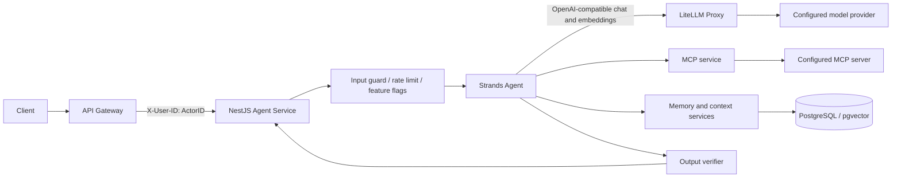

# ShopNexus Agent

A small NestJS service that provides conversational shopping support for ShopNexus users. It runs a Strands Agents loop, routes model and embedding requests through LiteLLM, obtains business tools from a configured MCP server, and persists sessions, transcripts, and user-scoped memories in PostgreSQL with pgvector.

This repository contains the **agent service only**. Authentication, business-domain authorization, and authoritative product/order data belong to the API Gateway and downstream domain services.

## Architecture



### Request lifecycle

1. The Gateway authenticates the caller and forwards its canonical actor ID in `X-User-ID`. The agent validates the header's presence and shape, but does **not** authenticate JWTs or sessions.
2. The controller scopes chat, sessions, and memory operations to that actor. A supplied session is checked for ownership before use.
3. The agent applies request guards, restores recent transcript context, prepares its model/tools, and invokes the Strands agent loop. The configured turn timeout is 60 seconds; cancellation is cooperative for underlying model/tool work.
4. Tool calls are checked against the configured allowlist/schema and relevant feature/authZ gates. Tool outputs are capped; oversized output can be paged through `read_output`.
5. The final response is passed through output verification. Turn/transcript and eligible user facts are persisted; persistence failures are best-effort and may not fail the response.

### Components

| Component | Responsibility |
|---|---|
| `src/agent` | HTTP controller, Strands orchestration, prompt/context assembly, timeout, tool hooks and output cap |
| `src/guardrails` | Input/output checks, tool validation, loop detection, rate limiting, feature flags and audit logging |
| `src/llm` | Strands `OpenAIModel` and embedding client configured against LiteLLM |
| `src/memory` | Actor-scoped fact extraction, memory CRUD/hybrid retrieval and transcript context reconstruction |
| `src/db` | Prisma client lifecycle and actor/session/turn repositories |
| `src/session` | Session lifecycle and ownership checks |
| `src/mcp` | MCP client and tools from `MCP_SERVER_URL`, connected at service startup |
| `prisma/` | Prisma schema and database migrations |
| `mock-mcp/` | Standalone mock MCP server and test UI |

The MCP URL is configured at startup. Although MCP server persistence code exists, it is not used for dynamic runtime server installation. Business data such as current prices, stock, carts, orders, and shipping status must come from authoritative domain tools, not model knowledge or memory.

## Memory and conversation context

- Short-term context is reconstructed from persisted messages for the current actor/session; reasoning blocks are not replayed. History is bounded by `AGENT_CONVERSATION_WINDOW`.
- Long-term memory stores eligible, directly stated user facts and preferences. Extraction is deterministic/pattern-based, not semantic LLM extraction. Memory retrieval uses PostgreSQL full-text search and pgvector with reciprocal-rank fusion.
- Memory reads and writes are actor-scoped. The HTTP API supports listing, updating, and deleting memories. Deletion is a soft delete; physical purge/backup retention is not implemented here.
- Memory is personalization context only. It is not a source of truth for live commerce data or a substitute for domain authorization.

## Gateway identity contract

All HTTP endpoints require `X-User-ID`, supplied by the trusted internal Gateway. The agent does not authenticate the request or verify the header's origin; deployment must prevent direct untrusted access to the service. Do not accept a client-provided actor ID as identity.

## HTTP API

| Method | Path | Description |
|---|---|---|
| `POST` | `/chat` | Send a message; accepts `message`, optional `sessionId` and `context`; creates a session if omitted |
| `POST` | `/sessions` | Create a session |
| `GET` | `/sessions` | List the caller's sessions |
| `GET` | `/memory` | List the caller's active memories |
| `PATCH` | `/memory/:id` | Update a memory's content |
| `DELETE` | `/memory/:id` | Forget one memory |
| `DELETE` | `/memory` | Forget all the caller's memories |

Example (the Gateway-to-agent internal request contract):

```bash
curl -X POST http://localhost:3000/chat \
  -H 'Content-Type: application/json' \
  -H 'X-User-ID: <actor-id-from-gateway>' \
  -d '{"message":"Recommend running shoes in my usual size","context":{"locale":"en"}}'
```

## Local development

### Requirements

- Node.js and npm
- Docker with Docker Compose
- LiteLLM provider credentials configured for the selected model in `docker/litellm-config.yaml`

### Start dependencies and service

```bash
npm install
cp .env.example .env
# Set provider credentials and local settings in .env.
# Configure the database URL/credentials and MCP_SERVER_URL as needed.
docker compose -f docker/docker-compose.yml up -d
npm run start:dev
```

The Compose stack starts LiteLLM Proxy and PostgreSQL with pgvector. The NestJS service and optional mock MCP server run separately. The SQL initialization script runs when PostgreSQL creates a new data volume; use Prisma migrations for schema changes on existing databases.

Other entrypoints:

```bash
npm run chat       # Interactive CLI
npm run demo       # Scripted demo
npm run mock:mcp   # Mock MCP server (separate process)
```

## Configuration

Defaults and validation are defined in `src/config.ts`; see `.env.example` for the local template.

| Variable | Default | Purpose |
|---|---|---|
| `PORT` | `3000` | HTTP port |
| `AGENT_MODEL_ID` | `gemini-2.5-flash` | Model routed through LiteLLM |
| `AGENT_MAX_TOKENS` | `4096` | Model output token limit |
| `AGENT_THINKING_BUDGET` | `0` | Optional provider/model thinking budget |
| `AGENT_MAX_TURNS` | `0` | Tool-use turn limit; zero means no configured cap |
| `AGENT_CONVERSATION_WINDOW` | `40` | Recent conversation messages |
| `AGENT_TOOL_OUTPUT_CAP` | `20000` | Maximum tool-result characters before spill/paging |
| `AGENT_MEMORY_ENTRY_CAP` | `500` | Maximum characters per injected memory entry |
| `LITELLM_BASE_URL` | `http://localhost:4000/v1` | LiteLLM API base URL |
| `LITELLM_API_KEY` | `sk-local-dev-key` | LiteLLM API key (local default only) |
| `GEMINI_API_KEY` | empty | Provider credential used by the local LiteLLM configuration |
| `EMBEDDING_MODEL_ID` | `text-embedding-default` | Embedding model route through LiteLLM |
| `DATABASE_URL` | built from `POSTGRES_*` | PostgreSQL connection string |
| `POSTGRES_USER` | `postgres` | PostgreSQL user |
| `POSTGRES_PASSWORD` | `postgres` | PostgreSQL password (local default only) |
| `POSTGRES_HOST` | `localhost` | PostgreSQL host |
| `POSTGRES_PORT` | `5432` | PostgreSQL port |
| `POSTGRES_DB` | `shopnexus_agent` | Database name |
| `MCP_SERVER_URL` | empty | MCP server endpoint configured at startup |

Feature flags `FEATURE_ALL_AGENT`, `FEATURE_LLM`, and `FEATURE_ORDER_STATUS` are also read directly from the environment; they default to enabled and are disabled only when set to `false`.

## Tests and checks

```bash
npm run build
npm run test:memory
npm run test:session-ownership
npm run test:agent-timeout
npx ts-node test/guardrails-test.ts
npx prisma validate
```

`test/guardrails-test.ts` is a standalone assertion harness and currently has no dedicated npm script.

## Known boundaries

- The agent trusts `X-User-ID` as an internal Gateway contract; ingress/network controls must restrict access.
- Order ownership must also be enforced by the downstream domain service. The agent's guardrail is not a replacement for domain authorization.
- The 60-second timeout sends a cancellation signal, but cancellation depends on the SDK/provider/tool honoring it.
- Rate limiting and feature-flag overrides are process-local; rate limits are not shared across replicas.
- Turn and memory persistence is best-effort. A response can succeed even if persistence fails.
- Memory extraction is limited to supported direct-phrase patterns and can skip other valid phrasings.
- Memory deletion is soft deletion, not physical erasure.
- PII checks are pattern-based and do not constitute comprehensive data-loss prevention.
- Validate Prisma migrations and pgvector dimensions/indexes against the target PostgreSQL deployment before rollout.
