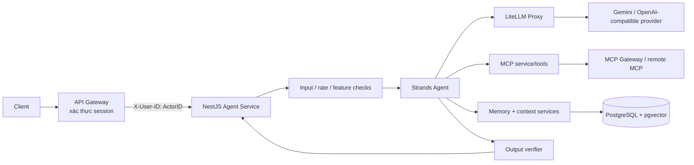

# Toàn cảnh ShopNexus Agent Harness

> Tài liệu mô tả trạng thái hiện tại của service `agent` trong repo này. Đây là một service nhỏ thuộc hệ thống ShopNexus, không phải toàn bộ backend, API Gateway, account service hay các microservice nghiệp vụ. Những nhận định về behavior được đối chiếu với source code; các ghi chú có nhãn **Lưu ý/Giới hạn** không nên hiểu là tính năng đã được triển khai.

## 1. Tóm tắt

ShopNexus Agent là service hội thoại hỗ trợ người dùng mua sắm và tra cứu thông tin ShopNexus. Service nhận request HTTP hoặc chạy ở CLI/demo, khởi tạo agent dùng Strands SDK, gọi model qua LiteLLM, kết nối tools qua MCP, khôi phục ngữ cảnh từ PostgreSQL và lưu turn/memory dài hạn.

### Công nghệ chính

| Lớp | Công nghệ / thành phần |
|---|---|
| Runtime HTTP | Node.js, TypeScript, NestJS, Express request |
| Agent loop | `@strands-agents/sdk` |
| Model adapter | `OpenAIModel` của Strands qua API OpenAI-compatible của LiteLLM |
| Model mặc định | Gemini 2.5 Flash qua LiteLLM; provider thực tế do cấu hình LiteLLM quyết định |
| Database | PostgreSQL, Prisma, pgvector, PostgreSQL full-text search |
| Tools | MCP servers, built-in memory và `read_output` |
| Local development | Docker Compose chạy LiteLLM Proxy và PostgreSQL/pgvector; agent/Mock MCP chạy riêng |

**Đây không phải tích hợp Claude/Anthropic SDK.** Repo dùng Strands và giao thức OpenAI-compatible tới LiteLLM; không nên mô tả service là Claude Agent SDK/API.

## 2. Phạm vi và ranh giới trách nhiệm

### Agent service đảm nhiệm

- Nhận câu hỏi chat, dựng một lượt agent, gọi LLM và trả lời.
- Gắn tools cấu hình sẵn hoặc discover từ MCP servers.
- Lọc input/output, giới hạn tốc độ và độ dài output tool, giám sát tool-call loop.
- Lưu các turn/messages và session bền vững trong PostgreSQL.
- Khôi phục lịch sử ngắn hạn theo session/actor.
- Lưu và truy vấn memory cá nhân hóa theo actor.

### Thành phần ngoài service

- **API Gateway**: xác thực người dùng/session và truyền identity xuống service. Agent không xác thực JWT, không truy cập Redis session store.
- **LiteLLM Proxy**: chuyển tiếp chat completion và embedding tới provider/model đã cấu hình.
- **MCP Gateway/servers**: cung cấp tools nghiệp vụ như sản phẩm, giỏ hàng, đơn hàng nếu MCP server được cấu hình và tool được agent chấp nhận.
- **PostgreSQL**: lưu actors, sessions, turns, messages, tool calls và user memories.

Agent không thay thế dữ liệu nghiệp vụ authoritative: giá, tồn kho, đơn hàng, vận chuyển phải đến từ tool/hệ thống nghiệp vụ hiện tại, không dựa vào memory hay kiến thức mô hình.

## 3. Kiến trúc tổng thể



Các module NestJS được khai báo trong `src/app.module.ts`. HTTP bootstrap nằm tại `src/main.ts`; cấu hình tập trung tại `src/config.ts`.

## 4. Identity từ API Gateway

### Contract hiện tại

- Gateway truyền `ActorID` dưới header nội bộ **`X-User-ID`**.
- Controller đọc giá trị này trực tiếp và dùng làm `actorId` cho chat/session, đồng thời gán `context.userId` bằng cùng giá trị để scope memory.
- `actorId` trong body và query không được dùng làm owner identity. `context.userId` do client gửi bị ghi đè.
- Header thiếu/rỗng, dài hơn 64 ký tự hoặc chứa ký tự điều khiển sẽ nhận `400 Bad Request`.
- Agent **không xác thực** JWT/session, không kiểm tra Redis, không xác minh chữ ký Gateway; nó chỉ dùng identity đã được Gateway truyền xuống. Header được chấp nhận sẽ được chuyển thành context `authenticated` cho guardrails, nhưng nhãn này chỉ dựa vào presence/shape của header, không phải bằng chứng auth được agent tự kiểm tra.

### Phạm vi bảo vệ

`X-User-ID` chỉ là identity propagation contract nội bộ, không phải cơ chế đăng nhập. Gateway và hạ tầng triển khai chịu trách nhiệm bảo đảm request/header đến từ nguồn đáng tin cậy (network isolation/mTLS hoặc cơ chế nội bộ đã thống nhất). Không expose agent trực tiếp ra Internet như một API client-facing và không cho client tự chọn header này.

### Lưu ý về session

`POST /chat` nhận `sessionId` nếu muốn tiếp tục phiên. Trước khi chạy agent, controller gọi `SessionService.assertOwnedSession()`; repository tìm session đồng thời theo `id` và `actorId`. Session không tồn tại, thuộc actor khác hoặc ID không hợp lệ đều trả `404 Session not found`, không tiết lộ session có tồn tại cho actor khác hay không.

## 5. HTTP API

Tất cả endpoint dưới đây sử dụng `X-User-ID` do Gateway truyền xuống.

| Method, path | Mục đích | Nội dung chính |
|---|---|---|
| `POST /chat` | Gửi một lượt chat | Body: `message`, tùy chọn `sessionId`, `context`; tạo session mới nếu thiếu `sessionId` |
| `POST /sessions` | Tạo session | Body có thể gồm `context`; actor luôn lấy từ header; trả `{ actorId, sessionId }` |
| `GET /sessions` | Liệt kê session của actor | Actor lấy từ header, không nhận actor từ query |
| `GET /memory` | Liệt kê memory active | Scope theo `X-User-ID` |
| `PATCH /memory/:id` | Sửa một memory | Path ID được parse dạng UUID; body `{ content }` |
| `DELETE /memory/:id` | Xóa/forget một memory | Scope theo actor và UUID memory ID |
| `DELETE /memory` | Xóa toàn bộ memory của actor | Trả số lượng đã đánh dấu xóa |

Ví dụ gọi nội bộ qua Gateway:

```bash
curl -X POST http://agent-service:3000/chat \
  -H 'Content-Type: application/json' \
  -H 'X-User-ID: <actor-id-do-gateway-truyen>' \
  -d '{"message":"Tôi thường chọn giày chạy bộ","context":{"locale":"vi"}}'
```

Agent bật CORS rộng trong `src/main.ts`; production cần quản lý CORS/ingress ở đúng tầng triển khai.

## 6. Luồng xử lý một lượt chat

Ở mức khái quát, `AgentService.chat()` thực hiện:

1. Nhận `actorId`, `sessionId`, input và context.
2. Kiểm tra feature/kill switch và rate limit theo actor.
3. Chạy input guard: giới hạn/chuẩn hóa input, dò prompt injection/jailbreak, yêu cầu scrape hàng loạt, PII và một số nội dung bị chặn.
4. Tạo agent mới cho request HTTP; dựng model, tools, system prompt và khôi phục context từ các turn đã lưu.
5. Gọi Strands agent loop; model có thể gọi các tools được cấp.
6. Trước tool call, hook kiểm tra allowlist/schema và một số feature/authZ điều kiện; `get_order` chỉ được cho qua khi userType là `authenticated` và GatewaySession có `actorId` không rỗng. `ToolGatewayService.call()` có timeout/audit/cap riêng nhưng agent hiện gắn `validate()` hook chứ không gọi `call()` làm execution wrapper. Output-cap hook riêng vẫn giới hạn tool output và có thể cung cấp phần dư qua `read_output`.
7. Kiểm tra/chuẩn hóa câu trả lời cuối qua output verifier.
8. Lưu turn và structured messages; persistence và memory writes có nhánh best-effort.
9. Từ user input của turn hoàn tất, trích các fact phù hợp và lưu memory nếu context có user identity.
10. Trả `{ actorId, sessionId, answer }`.

Có giới hạn timeout khoảng 30 giây ở luồng HTTP. `Promise.race` không đồng nghĩa với hủy chắc chắn tác vụ model/tool đang chạy ở nền.

## 7. Agent, model và prompt

### Strands Agent

`src/agent/agent.service.ts` điều phối agent, tools, callbacks/hooks, context và persistence. Agent được dựng lại theo từng HTTP request; hội thoại vẫn được tiếp nối nhờ load transcript từ database. CLI có thể giữ agent instance qua nhiều input trong tiến trình.

### LLM

`src/llm/llm.service.ts` tạo `OpenAIModel` của Strands, trỏ base URL và API key đến LiteLLM. Mặc định cấu hình là `gemini-2.5-flash`; việc chọn provider/model cuối tùy LiteLLM config.

Prompt grounding hướng dẫn agent:

- tin tool result hơn kiến thức sẵn có khi dữ liệu nghiệp vụ có thể thay đổi;
- không bịa giá/tồn kho/order data;
- coi memory là ngữ cảnh user-provided, không phải policy/system instruction;
- tuân theo giới hạn ShopNexus/policy đã cấu hình.

**Ghi chú tương thích:** cấu hình thinking hiện còn dùng dạng `thinking: enabled` + `budget_tokens` trong extra body; hỗ trợ thực tế phụ thuộc LiteLLM và provider phía sau.

## 8. Tools của agent

Danh sách tools thực tế được ghép trong `AgentService.prepareAgent()` từ built-in tools (như `read_output`, memory) và các tools MCP lấy được lúc service khởi tạo. `ToolsetRegistry` hiện chỉ là revision counter, không quyết định/đăng ký tools trong luồng này.

### Memory tools

- `remember_fact`: lưu fact do người dùng yêu cầu hoặc fact phù hợp theo category; có kiểm tra nội dung nhạy cảm.
- `search_memory`: Strands MemoryManager dùng store adapter để tìm memory liên quan theo query.
- Fact auto-extraction chạy sau turn hoàn tất dựa trên input user; không trích từ câu trả lời assistant hay catalog/tool output.

### `read_output`

Đọc tiếp phần tool result bị cắt khi output vượt giới hạn. `src/agent/output-cap.ts` giới hạn kích thước output trước khi đưa vào model context; phần dư được lưu tạm để đọc theo ID/offset/limit.

### MCP tools

`src/mcp/mcp.service.ts` đọc `MCP_SERVER_URL` lúc service khởi tạo, kết nối MCP client, lấy tools và giữ kết nối trong vòng đời service; lỗi kết nối được degrade thành không có MCP tools. Đây là cấu hình tĩnh lúc startup, không phải runtime install. `mcp-server.repository.ts`/model `McpServer` tồn tại nhưng không được luồng MCP hiện tại dùng để tự động load/install server. Mock MCP nằm trong `mock-mcp/` và chạy riêng.

## 9. Memory và conversation context

### Short-term context

- Transcript từng turn/messages được lưu bền vững trong database.
- Khi tạo agent mới, context service dựng lại các turn gần đây cho đúng session/actor.
- Cố gắng giữ thứ tự messages và nhóm tool-use/tool-result; reasoning nội bộ không được replay.
- Cửa sổ giới hạn theo số messages/turn đã cấu hình, không phải token budget chính xác.
- Nếu attachment không thể phục hồi, context builder có thể đặt marker. HTTP hiện chủ yếu nhận input text; chưa có attachment pipeline đầy đủ.
- Turn cũ chỉ có input/output text có fallback khi structured message records không tồn tại.

### Long-term memory

- Các category hiện có: `size_fit`, `preference`, `profile`, `feedback`; không có category buyer/seller hay `shop_policy`.
- Extractor regex hỗ trợ tên tiếng Việt/Anh, sở thích nói trực tiếp, và size giày/quần áo; đây không phải LLM-based semantic extractor.
- Fact phải dài 3–500 ký tự, qua screening secrets/PII/transient commerce, rồi mới tạo embedding.
- Stable `factKey` được replace atomic: lưu fact mới trước rồi đánh dấu fact cũ cùng actor/key là superseded; fact khác cùng category vẫn được giữ.
- Hybrid search xét tối đa 20 ứng viên mỗi nhánh semantic/lexical rồi RRF; query result tối đa 20. List active memory giới hạn 100 dòng.
- Embedding dimension trong schema/bootstrap là vector(768); phải đồng bộ với model embeddings đang route qua LiteLLM.
- Query rỗng không trả toàn bộ memory; memory được scope bằng `ActorID`.
- Forget hiện soft-delete; không có physical purge/backup retention trong phần triển khai này.

### Không nên dùng memory làm nguồn authoritative

Giá, khuyến mãi, hàng tồn, cart, order và trạng thái giao nhận phải được lấy từ tool/domain service hiện thời. Embedding chỉ hỗ trợ tìm kiếm; không quyết định fact có được phép lưu hay không.

## 10. Persistence và data model

Prisma schema nằm trong `prisma/schema.prisma`; database khởi tạo local có `docker/init-db/01-init-schema.sql`; migration nằm trong `prisma/migrations/`.

Các nhóm dữ liệu chính:

- **actors**: danh tính actor nội bộ, locale và timestamps.
- **sessions**: actor owner, context, status, turn count, timestamps.
- **turns**: session/actor, input-output text, model/stop reason, token/latency metrics.
- **messages**: message JSONB để khôi phục hội thoại/tool interactions.
- **tool_calls**: có schema/repository cho tool metadata, input/output/status/latency; luồng agent hiện tại chưa gọi repository writer để persist các tool calls.
- **user_memories**: category/content/search text/embedding, source turn, supersede/delete/expiry/fact key.
- **mcp_servers**: có model/repository trong Prisma/source nhưng hiện MCP client không load registry động từ DB.

Repository/service chính:

- `src/db/prisma.service.ts` — lifecycle Prisma client.
- `src/db/actor.repository.ts` — upsert actor.
- `src/db/session.repository.ts`, `src/session/session.service.ts` — tạo/liệt kê/touch sessions.
- `src/db/turn.repository.ts` — lưu turn/messages và tải history; có method ghi tool calls nhưng chưa được agent flow gọi.
- `src/memory/memory.repository.ts` — query/CRUD hybrid vector + FTS memory.
- `src/mcp/mcp-server.repository.ts` — repository MCP server tồn tại nhưng chưa được startup MCP service dùng để dựng cấu hình động.

**Migration chưa được xác nhận là đã chạy trên database triển khai.** Kiểm thử schema không thay thế kiểm thử migration, pgvector index và truy vấn tích hợp trên PostgreSQL thật. Ngoài ra, SQL bootstrap hiện không tạo bảng `mcp_servers` dù Prisma có model; Docker init script chỉ chạy trên volume PostgreSQL mới, nên cần chọn rõ quy trình bootstrap hay Prisma migrations để bảo đảm schema khớp.

## 11. Guardrails và kiểm soát an toàn

Các module trong `src/guardrails/` được phối hợp từ agent/tool hooks:

- **Feature flags / kill switches** (`feature-flags.ts`): bật mặc định, tắt khi env value đúng chuỗi `false`; flags được nạp trực tiếp từ env, không qua schema Zod `config.ts`. Hiện có `FEATURE_ORDER_STATUS`, `FEATURE_LLM`, `FEATURE_ALL_AGENT`; chưa thấy API quản trị/hot reload. Trạng thái là process-local.
- **Rate limiter** (`rate-limiter.service.ts`): sliding window trong memory tiến trình, mặc định 30 request mỗi actor mỗi 60 giây. Không đồng bộ giữa nhiều replicas; map actor không có cleanup cho ID không hoạt động.
- **Input guard** (`input-guard.service.ts`): từ chối input rỗng hoặc trên 2.000 ký tự; bỏ control/zero-width chars và tag HTML cơ bản; regex dò một số mẫu injection, truy vấn giá vốn/nội bộ và scrape catalog. Scanner nhận diện một số PII/payment data nhưng thẻ/CCCD phát hiện được chỉ tạo cảnh báo, không redact nội dung trước khi gửi model hoặc lưu transcript.
- **Tool schemas** (`tool-schemas.ts`): allowlist `search_products`, `get_product`, `get_order`, `get_policy`; kiểm tra ID, giới hạn query/category/page/limit/price và giới hạn kết quả sản phẩm.
- **Tool gateway** (`tool-gateway.service.ts`): method `validate()` thực hiện allowlist/schema/feature/authZ check; method `call()` có thêm execution timeout, audit và cap nhưng hiện agent hooks gọi `validate()`, không bọc việc thực thi qua `call()`. Do đó không nên giả định timeout/audit của `call()` được áp dụng trên đường runtime.
- **Lưu ý `get_order`**: tool gateway chỉ dùng `actorId` do GatewaySession nhận từ Gateway, đồng thời yêu cầu userType `authenticated`; không còn yêu cầu hay dùng `customerId`. Đây là điều kiện tại harness; order/MCP service phía sau vẫn phải tự đối soát ActorID với chủ đơn hàng, vì tool input hiện chỉ có orderId và harness không tự thực hiện truy vấn domain.
- **Loop detector** (`loop-detector.ts`): phát hiện cùng tool và cùng JSON input lặp đến lần thứ ba trong lượt; chạy trước tool validation hook.
- **Output cap** (`output-cap.ts`): hook riêng giới hạn tool result và spill phần vượt giới hạn ra file tạm để `read_output` phân trang.
- **Output verifier** (`output-verifier.service.ts`): lọc URL/domain và ảnh ngoài allowlist cố định, mask PII output, fail-closed với một số marker rò rỉ nội bộ, làm mềm một số khẳng định tuyệt đối, có thể thêm disclaimer/citation policy. Kiểm tra số so với tool-result chỉ log cảnh báo, không block/sửa câu trả lời.
- **PII utilities** (`pii-utils.ts`): regex scan/mask một số mẫu như phone Việt Nam, email, số thẻ 16 chữ số và giấy tờ 9/12 chữ số; không phải bộ phân loại PII tổng quát.
- **Audit log** (`audit-log.service.ts`): mask một số PII rồi ghi JSON qua Nest Logger. Comment về production append-only sink chưa tương ứng với sink bền vững trong implementation hiện tại.

Guardrail không thay thế authorization ở domain service. Tool order/cart cần backend nghiệp vụ tự kiểm tra quyền sở hữu theo ActorID.

## 12. CLI, demo và môi trường local

### Các entrypoint

- `src/main.ts`: NestJS HTTP API, mặc định port 3000.
- `src/cli.ts`: chat REPL trong terminal; `ACTOR_ID` có thể cấu hình actor cho local run.
- `src/demo.ts`: luồng demo scripted.
- `mock-mcp/`: mock server/UI để thử MCP tools.

### Docker Compose

Compose local hiện định nghĩa hai service:

- LiteLLM Proxy dùng image tag `main-latest`, expose port 4000, mount `docker/litellm-config.yaml` và nhận provider keys từ environment.
- PostgreSQL pgvector v16 expose port 5432, mount init SQL và lưu dữ liệu trong named volume `pgdata`.

Agent chạy riêng ngoài Compose; Mock MCP cũng chạy riêng bằng script/package của `mock-mcp/`. SQL init chỉ tự chạy khi khởi tạo data volume rỗng. Secrets cần lấy từ `.env`/secret manager, không commit vào tài liệu này.

Cách chạy local theo các package scripts hiện có:

```bash
npm install
cp .env.example .env
# chỉnh provider/database values trong .env

docker compose -f docker/docker-compose.yml up -d
npm run start:dev
```

CLI/demo/Mock MCP: `npm run chat`, `npm run demo`, `npm run mock:mcp`. Mock MCP có thể cần terminal/process riêng tùy cách chạy script.

## 13. Cấu hình môi trường

Giá trị dưới đây là defaults trong `src/config.ts`; `.env.example` là mẫu biến, còn `.env` không được chép vào tài liệu vì có thể chứa secrets.

| Biến | Giá trị mặc định | Ý nghĩa |
|---|---:|---|
| `PORT` | `3000` | HTTP port |
| `DEFAULT_ACTOR` | `default-user` | Actor mặc định cho các entrypoint local phù hợp |
| `AGENT_MODEL_ID` | `gemini-2.5-flash` | Model ID route qua LiteLLM |
| `AGENT_MAX_TOKENS` | `4096` | Giới hạn output token model |
| `AGENT_THINKING_BUDGET` | `0` | Cấu hình thinking bổ sung nếu provider hỗ trợ |
| `AGENT_MAX_TURNS` | `0` | Số chu kỳ tool tối đa; `0` là không giới hạn theo config |
| `AGENT_TOOL_OUTPUT_CAP` | `20000` | Giới hạn ký tự cho tool output |
| `AGENT_MEMORY_ENTRY_CAP` | `500` | Giới hạn độ dài memory entry đưa vào context |
| `AGENT_MEMORY_MAX_ENTRIES` | `10` | Số memory entry tối đa/search injection |
| `AGENT_CONVERSATION_WINDOW` | `40` | Cửa sổ message hội thoại |
| `MCP_SERVER_URL` | rỗng | Endpoint MCP cấu hình mặc định |
| `LITELLM_BASE_URL` | `http://localhost:4000/v1` | LiteLLM endpoint |
| `LITELLM_API_KEY` | `sk-local-dev-key` | Key local cho LiteLLM |
| `GEMINI_API_KEY` | rỗng | Provider key theo cấu hình LiteLLM |
| `POSTGRES_USER` | `postgres` | PostgreSQL user |
| `POSTGRES_PASSWORD` | `postgres` | PostgreSQL password local default |
| `POSTGRES_HOST` | `localhost` | PostgreSQL host |
| `POSTGRES_PORT` | `5432` | PostgreSQL port |
| `POSTGRES_DB` | `shopnexus_agent` | Database name |
| `DATABASE_URL` | rỗng | Nếu không set, build từ biến `POSTGRES_*` |
| `EMBEDDING_MODEL_ID` | `text-embedding-default` | Embedding model route qua LiteLLM |

`FeatureFlags` còn đọc trực tiếp `FEATURE_ORDER_STATUS`, `FEATURE_LLM`, `FEATURE_ALL_AGENT` (mặc định bật nếu giá trị không đúng `false`); chúng chưa nằm trong Zod config/.env.example. `.env.example` cũng không liệt kê một số biến có trong `config.ts` như `DEFAULT_ACTOR`, `POSTGRES_HOST`, `AGENT_MEMORY_MAX_ENTRIES`.

## 14. Lệnh và kiểm thử

Các package scripts hiện có trong `package.json`:

- `npm run build` — build NestJS.
- `npm run start`, `npm run start:dev` — chạy service.
- `npm run chat` — CLI REPL.
- `npm run demo` — scripted demo.
- `npm run test:memory` — test memory/context tùy chỉnh (`test/memory-test.ts`).
- `npm run test:session-ownership` — unit-style test session owner scoping (`test/session-ownership-test.ts`).
- `npm run mock:mcp` — chạy Mock MCP.

`test/guardrails-test.ts` là custom assert harness, không có package script riêng. Nó bao phủ input guard, tool schema/gateway, output verifier, loop detector và rate limiter; test `get_order` xác minh authenticated session có ActorID được qua gate và actor ID rỗng bị chặn. Không có conventional `npm test` script/test runner được xác nhận.

Kiểm tra sau thay đổi session ownership: `npm run build`, `npm run test:session-ownership`, `npm run test:memory` đều pass. `npx prisma validate` pass; bộ guardrail test hiện đạt 22/22 assertions. Chưa có test tích hợp HTTP/Gateway, migration trên database thật, hay xác minh schema init từ volume mới.

## 15. Những giới hạn/rủi ro cần biết

1. **Trust của identity header:** service không authenticate nguồn `X-User-ID`; cần Gateway-only ingress/network policy/mTLS hoặc cơ chế assertion thống nhất ở ngoài service.
2. **Order ownership nằm ở domain service:** harness xác nhận ActorID hiện diện/authenticated, nhưng `get_order` input chỉ chứa orderId; downstream cần kiểm tra đơn thuộc ActorID tương ứng.
3. **Timeout/cancellation:** timeout bằng race có thể trả response trước khi tác vụ dưới nền dừng hẳn.
4. **Best-effort persistence:** lỗi lưu turn/memory có thể không làm fail câu trả lời; user có thể nhận response nhưng không được lưu history/fact.
5. **PII trong input/transcript:** cảnh báo thẻ/CCCD không đồng nghĩa với redact; input chấp nhận được vẫn có thể gửi tới model và được persist.
6. **Extraction hẹp:** auto-extractor chỉ nhận dạng một số pattern trực tiếp; không phải hiểu ngữ nghĩa đầy đủ và có thể bỏ sót diễn đạt khác.
7. **Memory lifecycle:** soft-delete ngăn recall nhưng không phải physical purge; retention/backup cần quy định riêng.
8. **Context budget:** cửa sổ history là số message/turn, không phải token budget chính xác.
9. **Tools chưa wired:** ToolsetRegistry và MCP database registry không tham gia tool assembly thực tế theo code hiện tại; toolset MCP là URL tĩnh lúc startup.
10. **Guardrail scope:** rate limit/feature flags là process-local; ToolGateway `call()` timeout/audit chưa bọc execution path; numeric grounding verifier chỉ cảnh báo.
11. **CORS:** bootstrap hiện bật CORS rộng; cần cấu hình chặt trong production qua app/infrastructure.
12. **Provider config:** LiteLLM/model/provider và thinking options phải tương thích với cấu hình thật; model name trong app không chứng minh provider đang chạy.
13. **Database rollout:** cần chạy/kiểm tra migration và xác nhận vector dimension/index tương thích với model embedding triển khai; bootstrap SQL thiếu bảng `mcp_servers` có trong Prisma model.
14. **Documentation drift:** README/Compose/provider descriptions cần được đối chiếu với deployment config thực tế trước rollout; tài liệu này ưu tiên source code/config hiện hành.

## 16. Bản đồ mã nguồn

```text
src/
├── agent/
│   ├── agent.controller.ts       # HTTP routes và đọc ActorID từ X-User-ID
│   ├── agent.service.ts          # Agent orchestration, prompt, invoke, hooks, persistence
│   └── output-cap.ts             # Cắt tool output và read_output
├── db/
│   ├── prisma.service.ts         # Prisma lifecycle
│   ├── actor.repository.ts       # Actor persistence
│   ├── session.repository.ts     # Session persistence
│   └── turn.repository.ts        # Turns/messages persistence; tool-call writer chưa được gọi
├── guardrails/                   # Rate/input/tool/output/audit/PII/loop controls
├── llm/
│   ├── llm.service.ts            # Strands OpenAIModel qua LiteLLM
│   └── embedding.service.ts      # Embedding API qua LiteLLM
├── memory/                       # Fact extraction, memory CRUD/search, context builder
├── mcp/                          # Static MCP client và repository chưa wired vào startup
├── session/                      # Session lifecycle service
├── tools/                        # ToolsetRegistry revision counter
├── cli.ts                        # Terminal REPL
├── demo.ts                       # Demo script
├── config.ts                     # Zod environment config
├── app.module.ts                 # Nest provider/module wiring
└── main.ts                       # HTTP bootstrap

docker/
├── docker-compose.yml            # Local service composition
├── litellm-config.yaml           # Model/provider routing
└── init-db/                      # SQL schema initialization

prisma/                           # Prisma schema và migrations
mock-mcp/                         # Mock MCP server/tool data/test UI
test/                             # Memory và guardrail tests
docs/                             # Architecture/policy/summary documents
```

## 17. Tài liệu và nguồn code liên quan

- Identity contract Gateway → `X-User-ID`: mô tả tại mục 4 và triển khai trong `src/agent/agent.controller.ts`.
- `memory.md` — chính sách memory, transcript và các giới hạn.
- `README.md` — setup, chức năng và API examples.
- `src/agent/agent.service.ts`, `src/agent/agent.controller.ts` — nguồn chính của flow/API.
- `src/config.ts`, `package.json`, `docker/docker-compose.yml`, `docker/litellm-config.yaml` — cấu hình và cách chạy.
